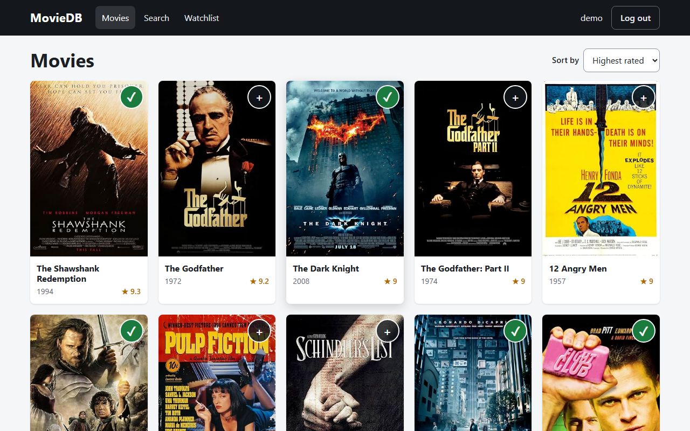
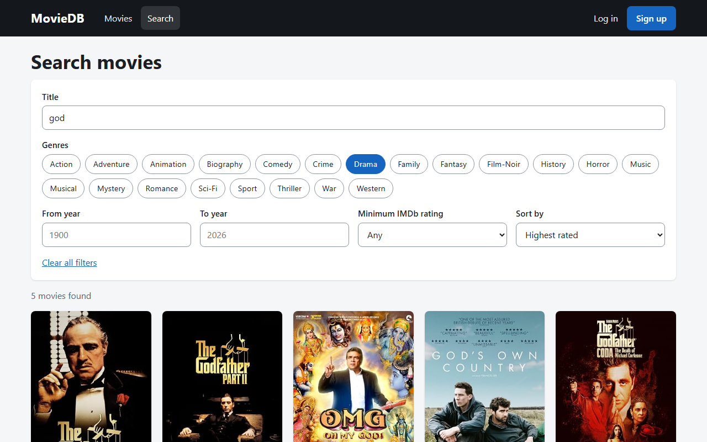
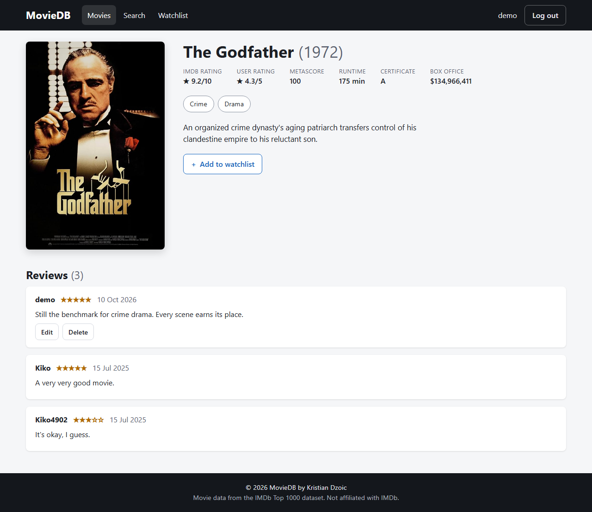
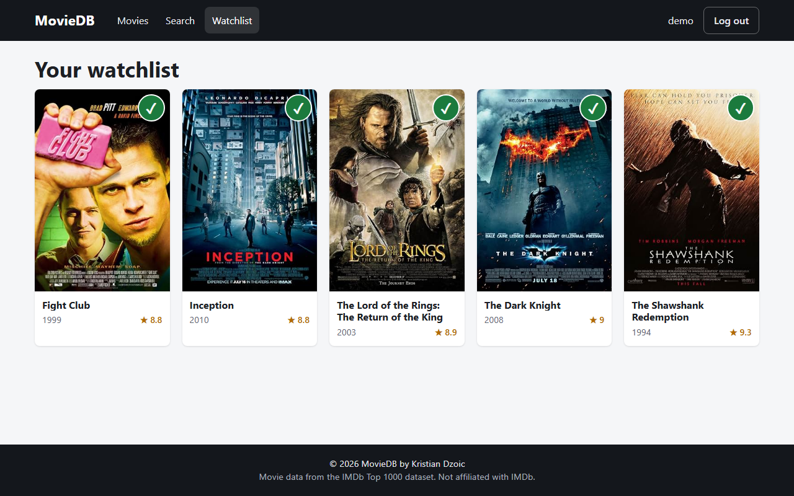
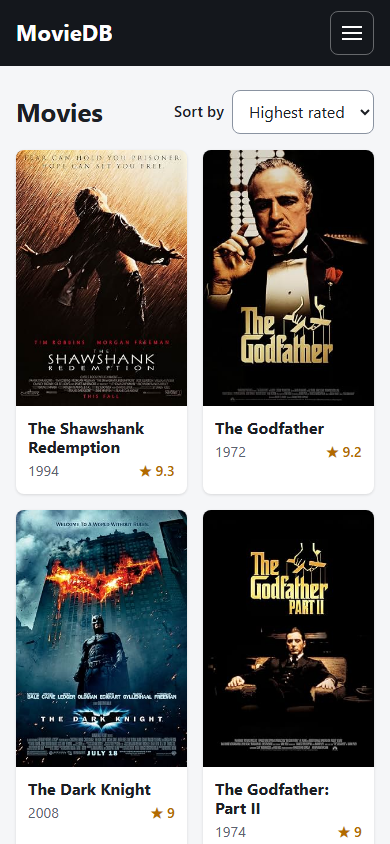
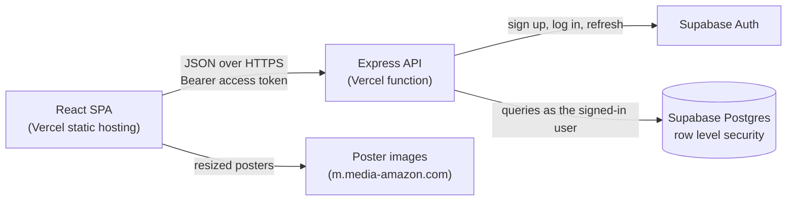

# MovieDB — frontend

[](https://github.com/kiko4902/movie-frontend/actions/workflows/ci.yml)

A movie catalogue where you can browse and search the IMDb Top 1000, keep a watchlist and write reviews. This repository is the React single-page app; the API lives in [web_project_backend](https://github.com/kiko4902/web_project_backend).

**Live:** https://movie-frontend-alpha-six.vercel.app

**Demo login:** open the [login page](https://movie-frontend-alpha-six.vercel.app/login) and press **Try the demo account**. No password is needed; the credentials stay on the API server.

## Screenshots

| Browse                                     | Search with filters                         |
| ------------------------------------------ | ------------------------------------------- |
|  |  |

| Movie detail and reviews                     | Watchlist                                    |
| -------------------------------------------- | -------------------------------------------- |
|  |  |



## Features

- Browse 1000 movies with pagination and sorting by rating, votes, year or title.
- Search as you type, combined with genre, year range and minimum rating filters. The filters live in the URL, so a search can be shared or bookmarked and the back button works.
- Movie pages with poster, genres, ratings and reviews.
- Sign up, log in, or use the one-click demo account.
- Write, edit and delete your own reviews with a 1 to 5 star rating.
- Add and remove watchlist movies from any card. The button updates immediately and rolls back if the request fails.
- Edit your username on the profile page.
- Sessions refresh in the background, and an expired session sends you back to the login page and returns you to where you were.
- Loading, empty and error states on every page, and a not-found page.
- Responsive from phone to desktop, keyboard accessible, with labelled controls.

## Architecture



The browser only ever talks to the API. It holds no Supabase key.

## Tech stack

- React 19 and React Router 7
- Vite 8
- Plain CSS, no UI framework
- Vitest, React Testing Library and jsdom
- ESLint (with `jsx-a11y` and `react-hooks`) and Prettier
- GitHub Actions for CI, Vercel for hosting

## Project layout

```
src/
  api/         fetch wrapper with token refresh, and the endpoint map
  context/     auth, watchlist and toast providers
  hooks/       useAsync, useDebouncedValue, usePageTitle
  components/  layout, movie card and grid, pagination, review form and list
  pages/       one file per route
  test/        test setup and render helpers
```

## Local setup

You need Node.js 20 or newer and a running copy of the [API](https://github.com/kiko4902/web_project_backend).

```bash
git clone https://github.com/kiko4902/movie-frontend.git
cd movie-frontend
npm install
cp .env.example .env.local   # then edit it
npm run dev                  # http://localhost:5173
```

### Environment variables

| Variable           | Required | Description                                                                 |
| ------------------ | -------- | --------------------------------------------------------------------------- |
| `VITE_API_URL`     | yes      | Base URL of the API, without a trailing slash, e.g. `http://localhost:3000` |
| `VITE_ENABLE_DEMO` | no       | Set to `true` to show the "Try the demo account" button                     |

Both are public values that end up in the built JavaScript. Do not put secrets in `VITE_` variables.

### Scripts

| Command                | What it does                           |
| ---------------------- | -------------------------------------- |
| `npm run dev`          | Start the dev server                   |
| `npm run build`        | Build for production into `dist/`      |
| `npm run preview`      | Serve the production build locally     |
| `npm test`             | Run the test suite once                |
| `npm run lint`         | Run ESLint                             |
| `npm run format`       | Format with Prettier                   |
| `npm run format:check` | Check formatting without writing files |

## Testing

`npm test` runs 64 tests across 5 files. They render real pages against a mocked `fetch` and cover the API client (token refresh, expiry, error handling), login, registration and the demo button, route guards, browsing and pagination, search filters and URL syncing, and the review and watchlist flows on the movie page.

CI runs lint, the format check, the tests and a production build on every push and pull request.

## Deployment

The app is deployed on Vercel, which builds every push to `master`.

- `vercel.json` sets the framework to Vite, rewrites all paths to `index.html` for client-side routing, caches hashed assets for a year and sends security headers.
- The Content Security Policy only allows requests to the production API and images from the poster host. If you deploy your own copy, change the `connect-src` value in `vercel.json` to your API URL.
- Set `VITE_API_URL` and `VITE_ENABLE_DEMO` in the Vercel project's environment variables. They are read at build time, so redeploy after changing them.
- The API must list this site's origin in its `CORS_ORIGINS` variable.

## Data

Movie data comes from the public IMDb Top 1000 dataset. This project is not affiliated with IMDb.
